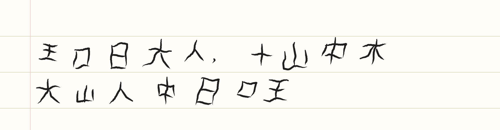
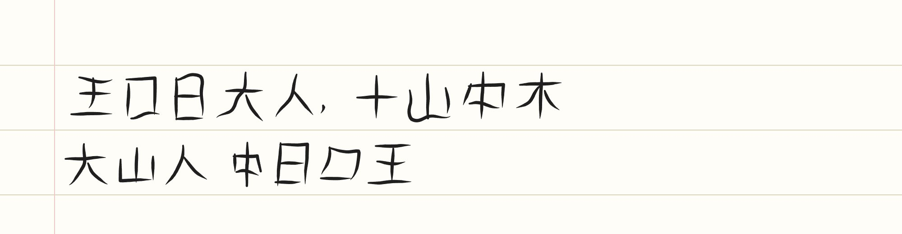

# 妙笔笔记

为华为 MatePad Pro 2022 + M-Pencil 设计的手写笔记应用，核心功能是**笔迹美化**。

| 美化前 | 美化后 |
|---|---|
|  |  |

## 功能

**笔记**：笔记列表（自动缩略图）、钢笔 / 荧光笔 / 橡皮 / 套索、5 种颜色、粗细调节、撤销重做、
横线 / 方格 / 空白纸张、行距调节、导出 PNG、自动保存（存在平板本地，无需联网）。

**笔迹美化**（✨ 按钮，或写完停笔约 1.3 秒自动进行）：

- **横平竖直**：把歪斜的横、竖拉直摆正，近似直线的笔画去掉抖动；横折、竖折会识别拐点后分段处理
- **纠正倾斜**：估计整行字的倾斜角度，把字“扶正”
- **大小统一、对齐横线**：把忽大忽小的字调整到接近的大小，并坐到横线上；标点保持小号、位置偏下
- **字距均匀**：字与字之间的距离变得一致
- **笔锋效果**：根据 M-Pencil 压感生成粗细变化，起笔收敛、快速收笔时出锋
- **美化强度**可调（0–100%），随时可以“还原为原始笔迹”，也可以用套索圈选只美化或还原一部分

## 操作

- M-Pencil 书写；**手指拖动翻页，双指缩放**（书写时手掌碰到屏幕不会画出痕迹）
- 没有手写笔时，在「⋯ 更多」里打开“手指也能书写”
- 套索圈选后可以拖动移动，或点“美化 / 原迹 / 删除”

## 安装到 MatePad

这是一个网页应用（PWA），不需要应用商店。

**方式一：放到 HTTPS 网站上（推荐）**
把整个文件夹上传到任意静态网站托管（GitHub Pages、Gitee Pages、Cloudflare Pages 等），
在平板浏览器打开网址 → 菜单 →“添加到桌面”。之后像普通 App 一样全屏打开，**断网也能用**。

**方式二：电脑局域网临时使用**
平板和电脑连同一个 Wi-Fi，在本文件夹运行：

```bash
python -m http.server 8765 --bind 0.0.0.0
```

平板浏览器打开 `http://<电脑的局域网IP>:8765`。
注意：这种方式需要电脑一直开着；笔记保存在平板浏览器里，与网址绑定，**电脑 IP 变了笔记就“看不到”了**，所以只适合试用。

## 文件结构

```
index.html            页面
css/style.css         样式
js/geometry.js        几何工具（重采样、平滑等）
js/beautify.js        笔迹美化引擎
js/render.js          笔画渲染（压感、笔锋）
js/db.js              本地存储（IndexedDB）
js/app.js             主程序（输入、工具、撤销、保存）
sw.js                 离线缓存
```
